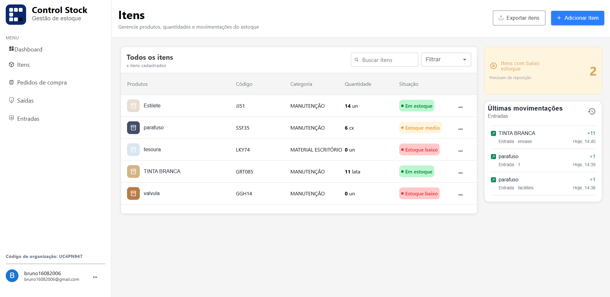
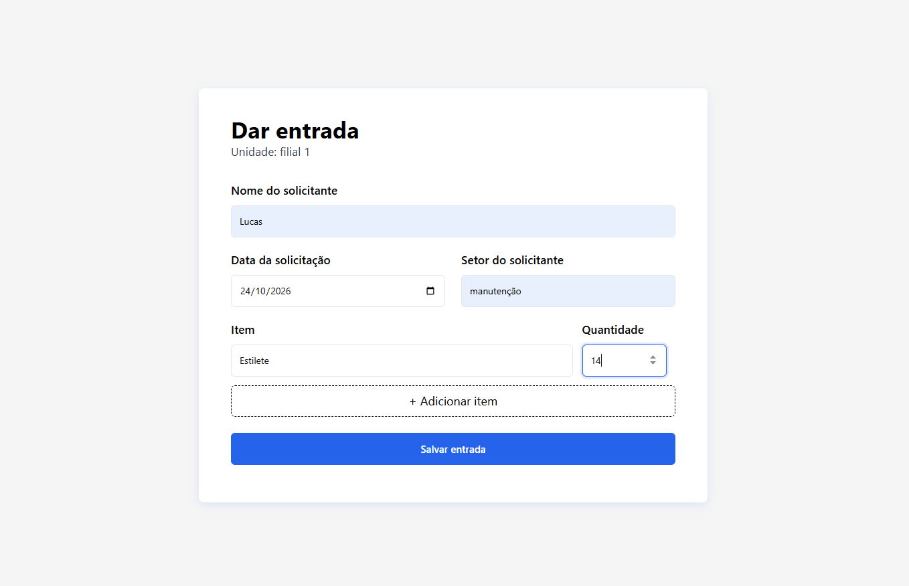
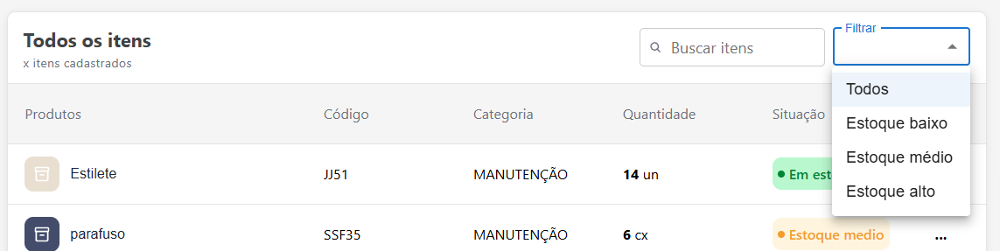

# ControlStock
sistema de controle de estoque feito para pequenos comércios ou uso pessoal que necessitam de um histórico de saídas e entradas de materiais.

# Link para acessar

https://control-stock-blush.vercel.app/

# Funcionalidades

- Organizações: o usuário pode criar uma organização ou utilizar o código de uma organização existente. Para uso pessoal, é possível utilizar uma organização própria.
- as organizações permitem que diferentes usuários compartilhem e gerenciem um mesmo estoque.
- Unidades: permitem organizar o estoque em diferentes locais ou setores, como filiais, TI e limpeza. Cada organização deve possuir pelo menos uma unidade.
- Dashboard: apresenta gráficos e indicadores para acompanhar itens com estoque baixo, gastos mensais, entradas e saídas da unidade selecionada.
- Gerenciamento de itens: permite cadastrar itens, registrar entradas e saídas e consultar o estoque.

- Filtros: permite filtrar itens por nome, valor e situação do estoque (baixo, médio ou bom).

- Pedidos de compra: permite registrar pedidos contendo múltiplos itens e acompanhar seus status. os valores dos pedidos são considerados nos gráficos e indicadores financeiros quando os pedidos estão com status de recebido.

# Tecnologias

Para o front-end utilizei React.js, para criar estados globais utilizei Redux e como banco de dados + back-end utilizei o supabase.

